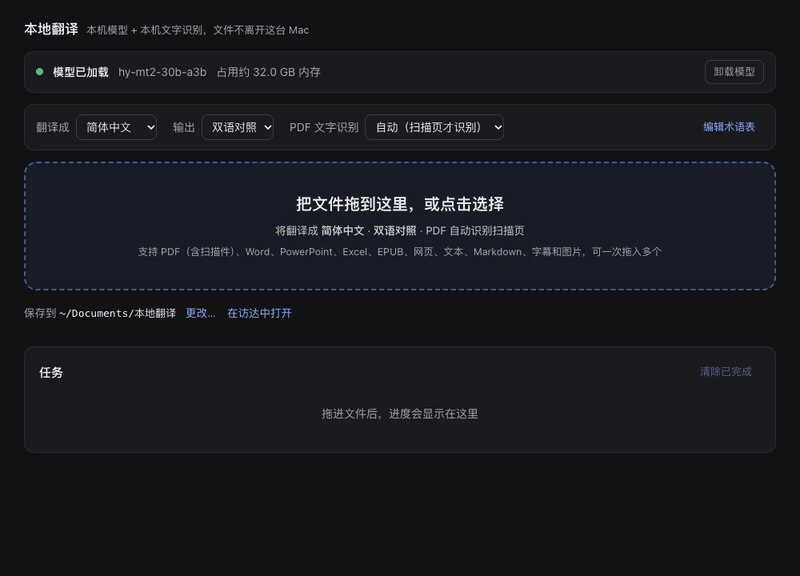
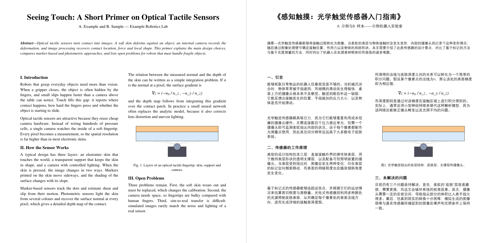
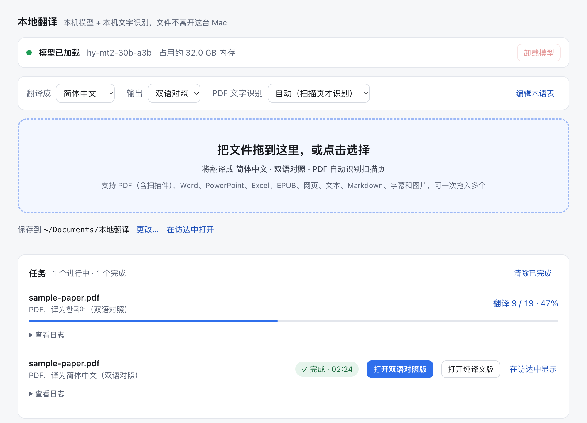
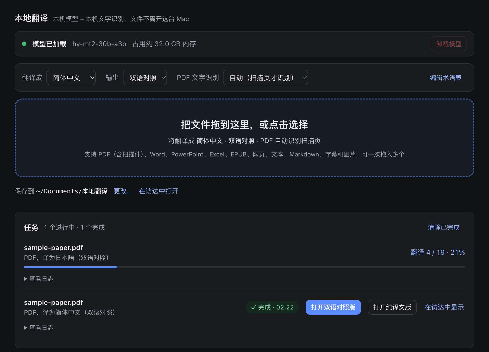
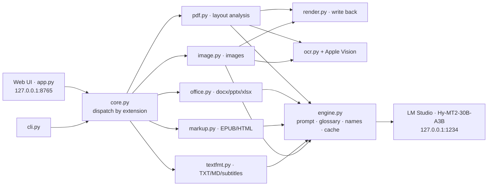

<div align="center">

<a href="https://zjywlive.github.io/LocalTranslator/">
  <picture>
    <source media="(prefers-color-scheme: dark)" srcset="assets/hero-dark.svg">
    
  </picture>
</a>

<p>
  <a href="LICENSE"></a>
  
  
  
  
  <a href="https://github.com/zjywlive/LocalTranslator/stargazers"></a>
</p>

<p>
  <b>English</b> · <a href="README.zh-CN.md">简体中文</a> ·
  <a href="https://zjywlive.github.io/LocalTranslator/">Website &amp; live demo</a> ·
  <a href="#quick-start">Quick start</a> ·
  <a href="#faq">FAQ</a>
</p>

<h3>Drop in a PDF. Get it back in Chinese — same layout, side by side with the original.<br>No cloud, no account, no API key.</h3>



</div>

---

## Contents

- [Why LocalTranslator](#why-localtranslator)
- [What it looks like](#what-it-looks-like)
- [Features](#features)
- [Supported formats](#supported-formats)
- [Quick start](#quick-start)
- [Usage](#usage)
- [How it works](#how-it-works)
- [Configuration](#configuration)
- [FAQ](#faq)
- [Roadmap](#roadmap)
- [Acknowledgements & license](#acknowledgements--license)

## Why LocalTranslator

| | Cloud translators | LocalTranslator |
|---|---|---|
| **Where your file goes** | Uploaded to someone else's server | Never leaves your Mac — the app only talks to `127.0.0.1` |
| **Layout** | Plain text, or a re-flowed copy | Translation written back **into the original boxes**: figures, vector art, formulas and tables stay put |
| **Bilingual reading** | Usually a paid feature | Original on the left, translation on the right, in one PDF |
| **Cost** | Per page / per character | Free, forever — runs on your own hardware |
| **Scanned pages** | Often unsupported | On-device OCR with Apple Vision |

> [!NOTE]
> LocalTranslator uses **Hy-MT2-30B-A3B**, an open translation model by Tencent, served by [LM Studio](https://lmstudio.ai). The model runs entirely on your machine; the first translation loads it automatically and it is unloaded after 15 idle minutes.

## What it looks like

**Bilingual output** — the translation is written into the same positions as the original text. Figures, the formula and the two-column layout are untouched:

<p align="center"></p>

**The app** — a small local web UI. Light and dark follow your system:

<p align="center">
  <picture>
    <source media="(prefers-color-scheme: dark)" srcset="assets/ui-dark.png">
    
  </picture>
</p>

<details>
<summary><b>See both themes side by side</b></summary>
<br>

| Light | Dark |
|---|---|
|  |  |

</details>

## Features

<table>
<tr>
<td width="33%" valign="top">

### 📐 Layout-preserving
Paragraphs are extracted with coordinates, the original glyphs are removed, and the translation is typeset back into the same box. Sentences split across columns or pages are joined, translated once, and split back.

</td>
<td width="33%" valign="top">

### 🔒 Fully offline
No cloud API, no account, no telemetry. The UI listens on `127.0.0.1` only; your documents and translations stay on disk.

</td>
<td width="33%" valign="top">

### 🧾 Bilingual PDF
Every PDF produces two files: `*.zh-dual.pdf` (original | translation, side by side) and `*.zh.pdf` (translation only).

</td>
</tr>
<tr>
<td valign="top">

### 🔍 On-device OCR
Pages without a text layer are detected automatically and read with Apple Vision. The text is painted over with the sampled background colour, then translated text is written on top.

</td>
<td valign="top">

### 📚 Glossary & names
A built-in robotics glossary plus your own `glossary.tsv` enforce fixed terms. Person names and titles of works are detected and kept in the original language.

</td>
<td valign="top">

### ⚡ Smart skipping & cache
Formulas, garbled math, acronyms (CONV, LSTM), URLs and numbers are left alone. Every paragraph is cached, so re-runs are instant.

</td>
</tr>
</table>

## Supported formats

| Format | How it's handled | Bilingual output |
|---|---|---|
| **PDF** | Layout-preserving rewrite; figures, vector art, formulas, table bodies and the reference list stay as they are | `*-dual.pdf` side by side + `*.zh.pdf` |
| **Scanned PDF, CBZ** | Pages without text are OCR'd with Apple Vision | Same as PDF |
| **XPS, MOBI, FB2** | Converted to PDF first | Same as PDF |
| **Word** (docx/docm/dotx) | Only text runs change — styles, images, tables, headers, footnotes are kept | Translation inserted after each paragraph |
| **doc, rtf, odt, wordml** | Converted to docx with macOS `textutil` | docx |
| **PowerPoint** (pptx) | Slides, notes and SmartArt text | Translation after each paragraph, text auto-fit on |
| **Excel** (xlsx) | Shared strings, inline cells, text boxes | `original ⏎ translation` in each cell |
| **EPUB, HTML** | Paragraphs, headings, lists, tables, captions; code untouched | Translation after each block; EPUB stays reflowable |
| **TXT, Markdown** | Markdown structure preserved; code blocks untouched | Translation after each paragraph |
| **SRT, VTT** | Timings preserved | Two lines per cue |
| **Images** (png/jpg/heic/tiff/webp…) | OCR → paint over → write translation | `*-dual.png` side by side |

Drop several files at once — they queue up and run one after another.

## Quick start

> [!IMPORTANT]
> Requirements: **macOS on Apple Silicon**, the system `python3` (comes with the Xcode Command Line Tools), [LM Studio](https://lmstudio.ai), and enough memory for the model — about **34 GB** for the Q8_0 build (48 GB Macs and up), or about **19 GB** for Q4_K_M (32 GB Macs).

**1 · Get the code**

```bash
git clone https://github.com/zjywlive/LocalTranslator.git
cd LocalTranslator
```

**2 · Install the one Python dependency** ([PyMuPDF](https://pymupdf.readthedocs.io))

```bash
/usr/bin/python3 -m pip install --user pymupdf
```

**3 · Download the translation model in LM Studio**

Open LM Studio, search for **`tencent/Hy-MT2-30B-A3B-GGUF`** and download `Hy-MT2-30B-A3B-Q8_0.gguf` (or `Q4_K_M` on a 32 GB Mac). Open LM Studio once so its command-line tool `~/.lmstudio/bin/lms` is installed. You don't need to load the model yourself.

**4 · Launch**

```bash
./build_app.sh          # creates ~/Applications/本地翻译.app — double-click it from now on
```

Or run it directly:

```bash
/usr/bin/python3 -E app.py --open
```

Your browser opens `http://127.0.0.1:8765`. Drop a file in. That's it.

<details>
<summary><b>Try it on the bundled sample</b></summary>
<br>

`examples/sample-paper.pdf` is a two-page, two-column paper written for this project (no copyrighted content). Translate it from the command line:

```bash
/usr/bin/python3 -E cli.py examples/sample-paper.pdf --to zh --mode dual --out examples/out
```

You get `examples/out/sample-paper.zh-dual.pdf` and `examples/out/sample-paper.zh.pdf`. The images in this README were made from exactly these files.

</details>

## Usage

### Web UI

> The interface text is currently in Simplified Chinese; documents can be translated into 14 languages (Chinese, Traditional Chinese, English, Japanese, Korean, French, German, Spanish, Portuguese, Italian, Russian, Arabic, Vietnamese, Thai).

1. Check the **settings bar** first: target language, bilingual or translation-only, PDF OCR mode. The drop zone repeats what will happen ("Translate to Simplified Chinese · bilingual").
2. **Drop files** (or click to choose). Each file becomes a task with live progress.
3. When a task is done, **Open translation** opens the result; **Show in Finder** reveals it.

The **engine bar** at the top shows whether the model is loaded and how much memory it uses. **Unload model** frees that memory (it asks first, and is disabled while a task is running).

### Command line

```bash
/usr/bin/python3 -E cli.py paper.pdf slides.pptx notes.md --to zh --mode dual --out ~/Documents/translations
```

| Option | Meaning |
|---|---|
| `--to` | Target language: `zh`, `zh-Hant`, `en`, `ja`, `ko`, `fr`, `de`, `es`, `pt`, `it`, `ru`, `ar`, `vi`, `th` |
| `--mode` | `dual` (bilingual, default) or `mono` (translation only) |
| `--out` | Output folder (default: next to the input file) |
| `--ocr` | `auto` (scanned pages only, default), `force`, `off` |
| `--unload` | Unload the model when finished |

## How it works

<p align="center">
  <picture>
    <source media="(prefers-color-scheme: dark)" srcset="assets/pipeline-dark.svg">
    
  </picture>
</p>



<details>
<summary><b>Design notes</b></summary>
<br>

- **One narrow interface.** Every format handler talks to the engine through a single call, `engine.translate_many(texts, tgt, progress)`. Handlers know nothing about LM Studio, prompts or caching — swapping the model touches one file.
- **Uniform handlers.** Each handler has the same signature, so adding a format is one line in `core.FORMATS`.
- **Names that stay names.** Hy-MT2 ignores free-form instructions like "keep names in English" but follows its terminology block strictly — so detected names are passed as `X → X` term entries.
- **Your models stay yours.** The model is loaded under its own identifier (`localtr`) with a TTL, so models you load yourself in LM Studio are never touched.

</details>

## Configuration

Settings live in `~/Library/Application Support/LocalTranslator/config.json` (created on first run).

<details>
<summary><b>All options</b></summary>
<br>

| Key | Default | Meaning |
|---|---|---|
| `model` | `hy-mt2-30b-a3b` | LM Studio model key |
| `identifier` | `localtr` | Identifier the model is loaded under |
| `workers` | `4` | Parallel requests to the model |
| `temperature` | `0.2` | Low = stable wording across runs |
| `context` | `8192` | Context length used when loading |
| `ttl` | `900` | Seconds of idle time before LM Studio unloads the model |
| `target` / `mode` / `ocr` | `zh` / `dual` / `auto` | Defaults shown in the UI |
| `output_dir` | `~/Documents/本地翻译` | Where results are written |
| `ocr_languages` | en, zh-Hans, zh-Hant, ja, ko, fr, de, es | Languages Apple Vision looks for |
| `glossaries` | `["robotics.tsv"]` | Built-in glossaries from `glossary/` |
| `keep_names` | `true` | Keep person names and titles untranslated |
| `port` | `8765` | Web UI port |

Your own glossary: `~/Library/Application Support/LocalTranslator/glossary.tsv` — one `source<TAB>translation` pair per line (optional third column: target language). The **Edit glossary** button opens it.

Logs: `~/Library/Logs/LocalTranslator.log` · Cache: `~/Library/Caches/LocalTranslator`

</details>

## FAQ

<details>
<summary><b>Does anything get sent over the network?</b></summary>
<br>
No. The web UI binds to <code>127.0.0.1</code>, and translation requests go to LM Studio's local server on <code>127.0.0.1:1234</code>. OCR uses Apple's on-device Vision framework. There is no analytics or update check in this project.
</details>

<details>
<summary><b>Why are formulas, tables and reference lists left in English?</b></summary>
<br>
On purpose. Translating math or table cells usually breaks them, and references are meant to be searched in their original form. Table captions and figure captions <i>are</i> translated.
</details>

<details>
<summary><b>Can I use a different model?</b></summary>
<br>
Yes — set <code>model</code> in <code>config.json</code> to any LM Studio model key. Prompts are tuned for Hy-MT2's official templates, so general chat models work but may be less consistent.
</details>

<details>
<summary><b>Does it work on Intel Macs, Windows or Linux?</b></summary>
<br>
Not today. OCR depends on Apple Vision and the launcher is macOS-specific. The translation core (PDF/Office/EPUB handling) is plain Python and PyMuPDF, so ports are possible — contributions welcome.
</details>

<details>
<summary><b>The output looks slightly different from the original. Why?</b></summary>
<br>
Chinese is usually shorter than English, so paragraphs may leave space below; inline bold/italic inside a single paragraph is not preserved. If text doesn't fit, the font is scaled down to stay inside the original box.
</details>

<details>
<summary><b>What about old <code>.ppt</code> / <code>.xls</code> files?</b></summary>
<br>
Save them as <code>.pptx</code> / <code>.xlsx</code> in PowerPoint or Excel first.
</details>

## Roadmap

- [x] Layout-preserving PDF with bilingual side-by-side output
- [x] Scanned PDFs and images via Apple Vision OCR
- [x] Word, PowerPoint, Excel, EPUB, HTML, Markdown, subtitles
- [x] Glossary and name protection
- [ ] Drag in whole folders
- [ ] Keep inline bold / italic inside paragraphs
- [ ] Translate text inside figures
- [ ] Linux / Windows OCR backends

## Acknowledgements & license

- [PyMuPDF](https://github.com/pymupdf/PyMuPDF) — PDF parsing and rendering (AGPL-3.0)
- [Hy-MT2](https://huggingface.co/tencent/Hy-MT2-30B-A3B-GGUF) by Tencent — the translation model (Apache-2.0; downloaded separately, not distributed here)
- [LM Studio](https://lmstudio.ai) — local model server
- Apple Vision — on-device OCR

LocalTranslator is released under the **[GNU AGPL-3.0](LICENSE)**, matching PyMuPDF's license.

<div align="center">
<br>

[](https://star-history.com/#zjywlive/LocalTranslator&Date)

<sub>If LocalTranslator saves you time, a ⭐ helps others find it. <a href="#contents">Back to top ↑</a></sub>

</div>
