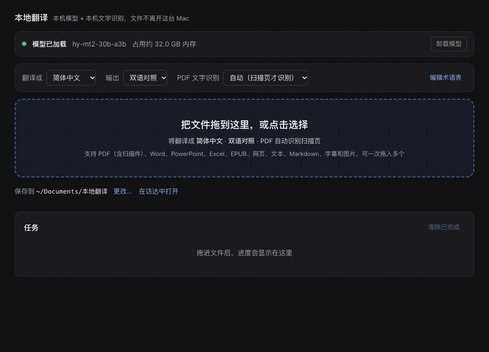
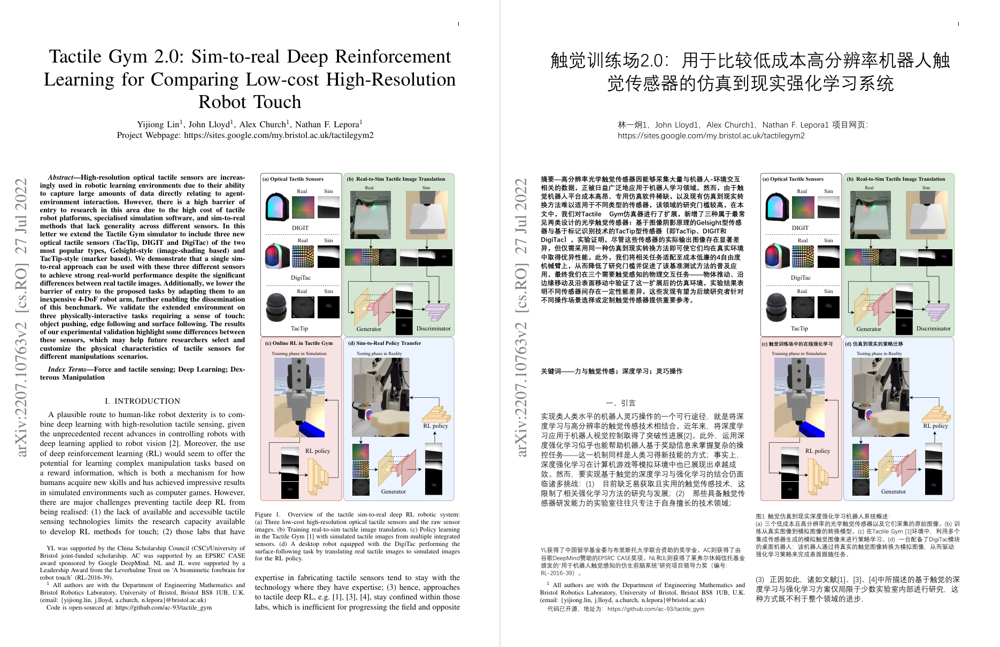
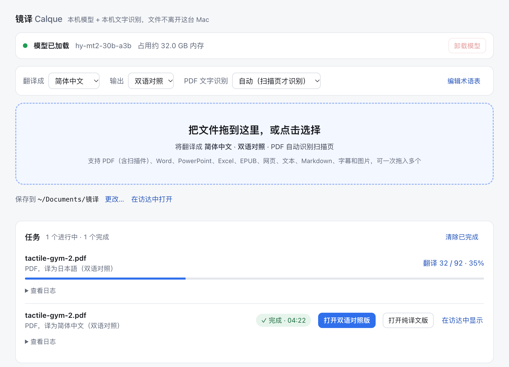
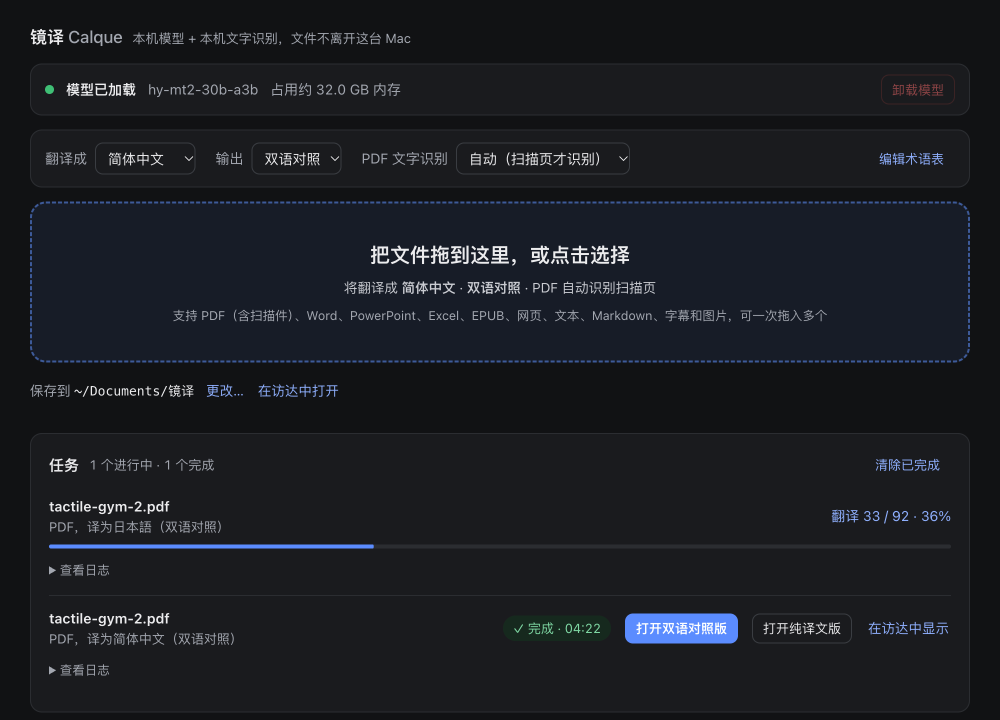
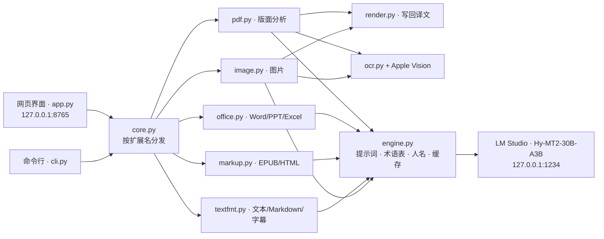

<div align="center">

<a href="https://zjywlive.github.io/Calque/">
  <picture>
    <source media="(prefers-color-scheme: dark)" srcset="assets/hero-dark.svg">
    
  </picture>
</a>

<p>
  <a href="LICENSE"></a>
  
  
  
  
  <a href="https://github.com/zjywlive/Calque/stargazers"></a>
</p>

<p>
  <a href="README.md">English</a> · <b>简体中文</b> ·
  <a href="https://zjywlive.github.io/Calque/">项目主页与在线演示</a> ·
  <a href="#快速开始">快速开始</a> ·
  <a href="#常见问题">常见问题</a>
</p>

<h3>拖进一篇英文 PDF，拿回排版不变的中文版，还能和原文左右对照。<br>不上云、不注册、不需要 API Key。</h3>



<sub><b>镜译</b>：左右两页像镜子一样一一对应。英文名 <b>Calque</b> 是语言学里的「仿译」，在法语里是「描摹」的意思：翻译文字，描下版面。</sub>

</div>

---

## 目录

- [为什么做这个](#为什么做这个)
- [效果](#效果)
- [功能](#功能)
- [支持的格式](#支持的格式)
- [快速开始](#快速开始)
- [使用方法](#使用方法)
- [工作原理](#工作原理)
- [配置](#配置)
- [常见问题](#常见问题)
- [路线图](#路线图)
- [致谢与许可证](#致谢与许可证)

## 为什么做这个

| | 在线翻译服务 | Calque |
|---|---|---|
| **文件去哪了** | 上传到别人的服务器 | 不离开你的 Mac，程序只访问 `127.0.0.1` |
| **排版** | 纯文本，或重新排过的版本 | 译文**写回原文的位置**，图片、矢量图、公式、表格都不动 |
| **双语对照** | 多半要付费 | 一个 PDF 里左边原文、右边译文 |
| **费用** | 按页或按字收费 | 免费，用你自己的电脑跑 |
| **扫描件** | 经常不支持 | 用 Apple Vision 在本机做文字识别 |

> [!NOTE]
> 翻译模型是腾讯开源的翻译专用模型 **Hy-MT2-30B-A3B**，由 [LM Studio](https://lmstudio.ai) 在本机运行。第一次翻译时自动加载，闲置 15 分钟后自动卸载。

## 效果

**双语对照输出**：译文写在原文的同一位置，图片、公式和双栏版式都保持原样。

<p align="center"><br><sub>示例页面：Y. Lin、J. Lloyd、A. Church、N. F. Lepora 的论文 <i>Tactile Gym 2.0</i>（<a href="https://arxiv.org/abs/2207.10763">arXiv:2207.10763</a>，<a href="https://creativecommons.org/licenses/by/4.0/">CC BY 4.0</a>），由 Calque 机器翻译。</sub></p>

**软件界面**：一个本地网页界面，深浅色跟随系统。

<p align="center">
  <picture>
    <source media="(prefers-color-scheme: dark)" srcset="assets/ui-dark.png">
    
  </picture>
</p>

<details>
<summary><b>同时看浅色和深色</b></summary>
<br>

| 浅色 | 深色 |
|---|---|
|  |  |

</details>

## 功能

<table>
<tr>
<td width="33%" valign="top">

### 📐 保留排版
按坐标提取段落，删掉原文字形，把译文排回同一个框里。跨栏、跨页断开的句子会先合并翻译，再拆回两处。

</td>
<td width="33%" valign="top">

### 🔒 完全离线
没有云端 API，没有账号，没有遥测。界面只监听 `127.0.0.1`，文档和译文都留在你的硬盘上。

</td>
<td width="33%" valign="top">

### 🧾 双语 PDF
每个 PDF 生成两个文件：`*.zh-dual.pdf`（原文和译文左右并排）和 `*.zh.pdf`（只有译文）。

</td>
</tr>
<tr>
<td valign="top">

### 🔍 本机文字识别
自动识别没有文字层的页面，用 Apple Vision 读出文字，按采样的背景色覆盖原文，再写入译文。

</td>
<td valign="top">

### 📚 术语表和人名
内置机器人学术语表，也可以加自己的 `glossary.tsv` 固定译法。人名和书名会被识别出来，保留原文。

</td>
<td valign="top">

### ⚡ 智能跳过与缓存
公式、乱码、缩写（CONV、LSTM）、网址和纯数字不翻译。每段译文都会缓存，重跑不用再等。

</td>
</tr>
</table>

## 支持的格式

| 格式 | 处理方式 | 双语输出 |
|---|---|---|
| **PDF** | 保留排版写回；图片、矢量图、公式、表格内容和参考文献保持原样 | `*-dual.pdf` 左右对照 + `*.zh.pdf` |
| **扫描版 PDF、CBZ** | 没有文字层的页面用 Apple Vision 识别 | 同 PDF |
| **XPS、MOBI、FB2** | 先转成 PDF | 同 PDF |
| **Word**（docx/docm/dotx） | 只改文字，样式、图片、表格、页眉页脚、脚注都保留 | 每段原文后插入译文 |
| **doc、rtf、odt、wordml** | 用系统自带的 `textutil` 转成 docx | 输出 docx |
| **PowerPoint**（pptx） | 幻灯片、备注、SmartArt 的文字 | 原段落后插入译文，并开启文字自动缩放 |
| **Excel**（xlsx） | 共享字符串、单元格文字、文本框 | 单元格里是「原文 ⏎ 译文」 |
| **EPUB、HTML** | 段落、标题、列表、表格、图注；代码不翻译 | 每段后附译文；EPUB 仍可正常重排 |
| **TXT、Markdown** | 保留 Markdown 结构；代码块不翻译 | 每段后附译文 |
| **SRT、VTT 字幕** | 保留时间轴 | 每条字幕显示原文和译文两行 |
| **图片**（png/jpg/heic/tiff/webp…） | 文字识别 → 覆盖原文 → 写入译文 | `*-dual.png` 左右对照 |

可以一次拖进多个文件，它们会排队依次处理。

## 快速开始

> [!IMPORTANT]
> 需要：**Apple Silicon 的 Mac**、系统自带的 `python3`（装 Xcode 命令行工具时附带）、[LM Studio](https://lmstudio.ai)，以及足够放下模型的内存：Q8_0 版约 **34 GB**（建议 48 GB 及以上内存），Q4_K_M 版约 **19 GB**（32 GB 内存的 Mac 可用）。

**1 · 下载代码**

```bash
git clone https://github.com/zjywlive/Calque.git
cd Calque
```

**2 · 安装唯一的 Python 依赖** [PyMuPDF](https://pymupdf.readthedocs.io)

```bash
/usr/bin/python3 -m pip install --user pymupdf
```

**3 · 在 LM Studio 里下载翻译模型**

打开 LM Studio，搜索 **`tencent/Hy-MT2-30B-A3B-GGUF`**，下载 `Hy-MT2-30B-A3B-Q8_0.gguf`（32 GB 内存的 Mac 选 `Q4_K_M`）。至少打开一次 LM Studio，让它装好命令行工具 `~/.lmstudio/bin/lms`。不需要手动加载模型。

**4 · 启动**

```bash
./build_app.sh          # 生成 ~/Applications/镜译.app，以后双击它就能打开
```

也可以直接运行：

```bash
/usr/bin/python3 -E app.py --open
```

浏览器会打开 `http://127.0.0.1:8765`，把文件拖进去就行。

<details>
<summary><b>用自带的示例论文试一下</b></summary>
<br>

`examples/tactile-gym-2.pdf` 是一篇开放获取的机器人学论文（Lin 等，*Tactile Gym 2.0*，arXiv:2207.10763），按 [CC BY 4.0](https://creativecommons.org/licenses/by/4.0/) 许可原样分发。用命令行翻译它：

```bash
/usr/bin/python3 -E cli.py examples/tactile-gym-2.pdf --to zh --mode dual --out examples/out
```

会得到 `examples/out/tactile-gym-2.zh-dual.pdf` 和 `examples/out/tactile-gym-2.zh.pdf`。本页的效果图就是用这次运行的结果做的。

</details>

## 使用方法

### 网页界面

1. 先看**设置条**：翻译成哪种语言、双语对照还是仅译文、PDF 要不要做文字识别。拖放区会复述这次的设置，比如「将翻译成 简体中文 · 双语对照」。
2. **拖入文件**（或点击选择），每个文件成为一个任务，实时显示进度。
3. 完成后点**打开双语对照版**或**打开纯译文版**查看结果，点**在访达中显示**找到文件。

顶部的**引擎栏**显示模型是否已加载、占用多少内存。**卸载模型**会释放这部分内存；点了会先确认，有任务在跑时不能卸载。

### 命令行

```bash
/usr/bin/python3 -E cli.py 论文.pdf 讲义.pptx 笔记.md --to zh --mode dual --out ~/Documents/译文
```

| 参数 | 含义 |
|---|---|
| `--to` | 目标语言：`zh`、`zh-Hant`、`en`、`ja`、`ko`、`fr`、`de`、`es`、`pt`、`it`、`ru`、`ar`、`vi`、`th` |
| `--mode` | `dual`（双语对照，默认）或 `mono`（仅译文） |
| `--out` | 输出文件夹（默认和原文件放在一起） |
| `--ocr` | `auto`（只识别扫描页，默认）、`force`（全部识别）、`off`（不识别） |
| `--unload` | 完成后卸载模型 |

## 工作原理

<p align="center">
  <picture>
    <source media="(prefers-color-scheme: dark)" srcset="assets/pipeline-dark.svg">
    
  </picture>
</p>



<details>
<summary><b>设计要点</b></summary>
<br>

- **接口很窄。** 各格式处理器只通过一个方法和翻译引擎打交道：`engine.translate_many(texts, tgt, progress)`。它们不知道 LM Studio、提示词和缓存的存在，换模型只改一个文件。
- **处理器签名统一。** 新增一种格式，只要在 `core.FORMATS` 里加一行。
- **人名保持原样。** Hy-MT2 不理会「人名保留英文」这类自由指令，但会严格遵守术语块，所以识别出的人名以「X 翻译成 X」的术语形式交给模型。
- **不碰你的模型。** 模型用独立的标识名（`localtr`）加载并设置闲置超时，你在 LM Studio 里自己加载的模型不受影响。

</details>

## 配置

配置文件在 `~/Library/Application Support/LocalTranslator/config.json`，第一次运行时自动生成。

<details>
<summary><b>全部选项</b></summary>
<br>

| 键 | 默认值 | 含义 |
|---|---|---|
| `model` | `hy-mt2-30b-a3b` | LM Studio 里的模型名 |
| `identifier` | `localtr` | 加载模型时用的标识名 |
| `workers` | `4` | 同时发给模型的请求数 |
| `temperature` | `0.2` | 越低，多次翻译的措辞越一致 |
| `context` | `8192` | 加载时的上下文长度 |
| `ttl` | `900` | 闲置多少秒后 LM Studio 自动卸载模型 |
| `target` / `mode` / `ocr` | `zh` / `dual` / `auto` | 界面上的默认值 |
| `output_dir` | `~/Documents/镜译` | 译文保存位置 |
| `ocr_languages` | 英、简中、繁中、日、韩、法、德、西 | Apple Vision 识别的语言 |
| `glossaries` | `["robotics.tsv"]` | `glossary/` 下启用的内置术语表 |
| `keep_names` | `true` | 人名和书名保留原文 |
| `port` | `8765` | 网页界面端口 |

自定义术语表：`~/Library/Application Support/LocalTranslator/glossary.tsv`，每行一对「原文<Tab>译文」，可选第三列为目标语言。界面上点**编辑术语表**即可打开。

日志：`~/Library/Logs/LocalTranslator.log` · 缓存：`~/Library/Caches/LocalTranslator`

</details>

## 常见问题

<details>
<summary><b>会不会把东西发到网上？</b></summary>
<br>
不会。网页界面只绑定 <code>127.0.0.1</code>，翻译请求发给本机 LM Studio 的 <code>127.0.0.1:1234</code>，文字识别用的是 Apple 本机的 Vision 框架。本项目没有任何统计或更新检查。
</details>

<details>
<summary><b>为什么公式、表格内容和参考文献不翻译？</b></summary>
<br>
有意为之。翻译数学符号或表格单元格通常会把它们弄坏；参考文献本来就要按原文检索。表题和图注<i>会</i>翻译。
</details>

<details>
<summary><b>能换别的模型吗？</b></summary>
<br>
可以，把 <code>config.json</code> 里的 <code>model</code> 改成任意 LM Studio 模型名。提示词按 Hy-MT2 官方模板调过，通用聊天模型也能用，但译法可能没那么稳定。
</details>

<details>
<summary><b>支持 Intel Mac、Windows 或 Linux 吗？</b></summary>
<br>
暂时不支持。文字识别依赖 Apple Vision，启动方式也是 macOS 专用的。翻译核心（PDF、Office、EPUB 处理）是纯 Python + PyMuPDF，移植是可行的，欢迎贡献。
</details>

<details>
<summary><b>译文版面和原文有点不一样？</b></summary>
<br>
中文通常比英文短，段落下方可能留白；同一段里个别加粗或斜体的词不会保留。如果译文放不下，会自动缩小字号，保证不超出原来的框。
</details>

<details>
<summary><b>旧版 <code>.ppt</code> / <code>.xls</code> 怎么办？</b></summary>
<br>
先在 PowerPoint 或 Excel 里另存为 <code>.pptx</code> / <code>.xlsx</code>。
</details>

## 路线图

- [x] 保留排版的 PDF 翻译，双语左右对照
- [x] 扫描版 PDF 和图片（Apple Vision 文字识别）
- [x] Word、PowerPoint、Excel、EPUB、HTML、Markdown、字幕
- [x] 术语表和人名保护
- [ ] 支持拖入整个文件夹
- [ ] 保留段落内的加粗和斜体
- [ ] 翻译图片里的文字
- [ ] Linux / Windows 的文字识别方案

## 致谢与许可证

- [PyMuPDF](https://github.com/pymupdf/PyMuPDF)：PDF 解析与渲染（AGPL-3.0）
- 腾讯 [Hy-MT2](https://huggingface.co/tencent/Hy-MT2-30B-A3B-GGUF)：翻译模型（Apache-2.0，需另行下载，本仓库不分发）
- [LM Studio](https://lmstudio.ai)：本地模型服务
- Apple Vision：本机文字识别
- 示例文档：Yijiong Lin、John Lloyd、Alex Church、Nathan F. Lepora 的论文 *Tactile Gym 2.0*（[arXiv:2207.10763](https://arxiv.org/abs/2207.10763)），按 [CC BY 4.0](https://creativecommons.org/licenses/by/4.0/) 使用。译文页面由 Calque 机器翻译，不代表原作者。

Calque 以 **[GNU AGPL-3.0](LICENSE)** 许可证发布，与 PyMuPDF 保持一致。

<div align="center">
<br>

[](https://star-history.com/#zjywlive/Calque&Date)

<sub>如果它帮你省了时间，点个 ⭐ 能让更多人看到。<a href="#目录">回到顶部 ↑</a></sub>

</div>
